<picture>
  <source media="(prefers-color-scheme: light) and (prefers-reduced-motion: reduce)" srcset="assets/hero-arm-light-still.jpg" />
  <source media="(prefers-color-scheme: dark) and (prefers-reduced-motion: reduce)" srcset="assets/hero-arm-still.jpg" />
  <source media="(prefers-color-scheme: light)" srcset="assets/hero-arm-light.webp" />
  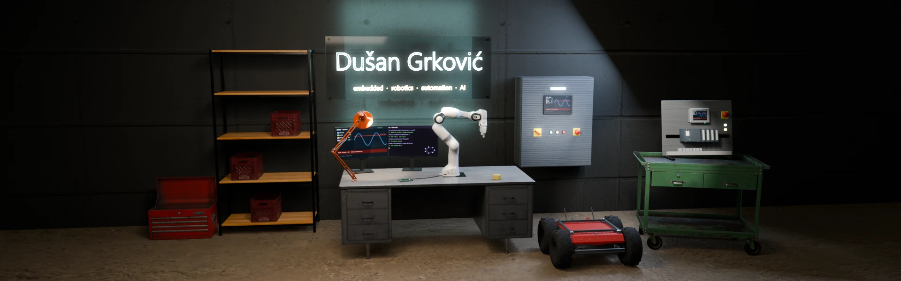
</picture>

I'm an electrical and computer engineer who works across embedded systems, robotics, and industrial automation. I build firmware and electronics, then develop the software to measure, test, and control them.

My projects range from a magnetic slip-sensing gripper to EV charging simulations and AI applications. I like work where software has a clear connection to the physical system.

## Projects

<a href="https://github.com/Grkila/Adaptive-Gripper-with-Micro-Vibration-Based-Slip-Detection"><picture><source media="(prefers-color-scheme: light)" srcset="assets/cards/light/gripper.svg" /></picture></a>
<a href="https://github.com/Grkila/Serial-Two-Joint-Robot-Manipulator-Simulation-and-Control"><picture><source media="(prefers-color-scheme: light)" srcset="assets/cards/light/manipulator.svg" /></picture></a>
<a href="https://github.com/Grkila/gdg-accessibility-agent"><picture><source media="(prefers-color-scheme: light)" srcset="assets/cards/light/silverone.svg" /></picture></a>
<a href="https://github.com/Grkila/gridlab-ev-grid-simulator"><picture><source media="(prefers-color-scheme: light)" srcset="assets/cards/light/gridlab.svg" />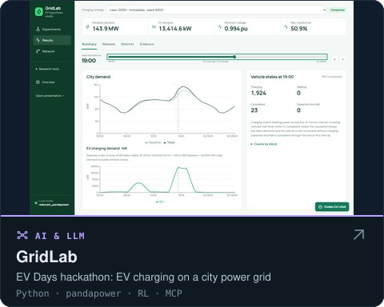</picture></a>
<a href="https://github.com/Grkila/SCADA-Industrial-Automation-Assignment"><picture><source media="(prefers-color-scheme: light)" srcset="assets/cards/light/scada.svg" />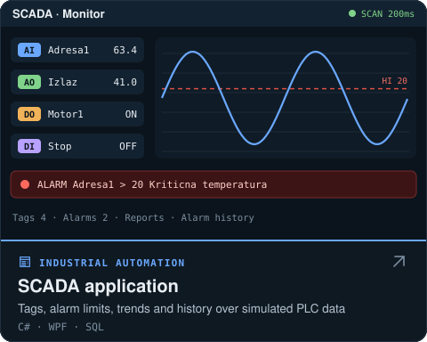</picture></a>
<a href="https://github.com/Grkila/Airlock-Control-System-HIL-Testbench"><picture><source media="(prefers-color-scheme: light)" srcset="assets/cards/light/airlock.svg" /></picture></a>
<a href="https://github.com/Grkila/MODBUS-for-intel-8051-microcontroller"><picture><source media="(prefers-color-scheme: light)" srcset="assets/cards/light/modbus.svg" />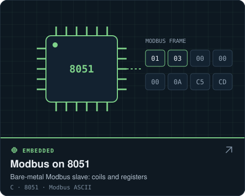</picture></a>
<a href="https://github.com/Grkila/Intro-Path-Discovery"><picture><source media="(prefers-color-scheme: light)" srcset="assets/cards/light/intro-paths.svg" /></picture></a>

<a href="https://github.com/Grkila/Siemens-S7-Practical-Programming-Projects"><picture><source media="(prefers-color-scheme: light)" srcset="assets/cards/light/siemens.svg" />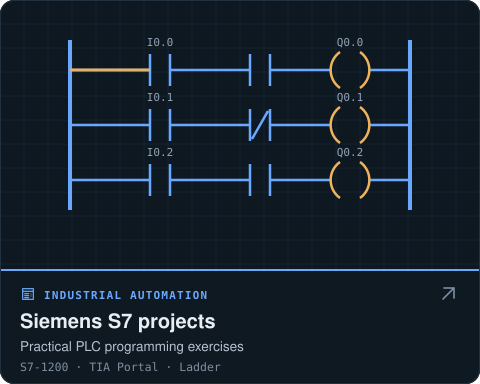</picture></a>
<a href="https://github.com/Grkila/Differential-Motion-Analyzer"><picture><source media="(prefers-color-scheme: light)" srcset="assets/cards/light/motion.svg" /></picture></a>
<a href="https://github.com/Grkila/Husarion-panther-sim-setup"><picture><source media="(prefers-color-scheme: light)" srcset="assets/cards/light/panther.svg" /></picture></a>
<a href="https://github.com/Grkila/husarion_ws"><picture><source media="(prefers-color-scheme: light)" srcset="assets/cards/light/husarion.svg" /></picture></a>
<a href="https://github.com/Grkila/Diabetes-prediction-using-machine-learning"><picture><source media="(prefers-color-scheme: light)" srcset="assets/cards/light/diabetes.svg" /></picture></a>
<a href="https://github.com/Grkila/Stock-price-prediction"><picture><source media="(prefers-color-scheme: light)" srcset="assets/cards/light/stock.svg" /></picture></a>

## Stack, from silicon to SCADA

<picture><source media="(prefers-color-scheme: light)" srcset="assets/stack-isometric-light.svg" /></picture>

<strong>Full list of technologies and tools</strong>

These cover my independent builds, team projects, and university coursework.

| Area | Technologies and tools |
| --- | --- |
| Languages | C, C++, Python, TypeScript, Java, C#, MATLAB, Bash, VHDL, SCL, Ladder Logic |
| Embedded systems | ESP32, STM32, AT89C51RC2 / 8051, FPGA, FreeRTOS, interrupts, GPIO, PWM, ADC/DAC, bare-metal firmware |
| Industrial automation | Siemens S7-1200 / S7-1500, TIA Portal, WinCC, UNICOS-CPC / UCPC, PLC programming, SCADA |
| Control and simulation | PID, fuzzy PID, sliding-mode control, MATLAB/Simulink, LabVIEW, real-time control, system modeling, FFT, signal filtering |
| Robotics | ROS 2 Jazzy, Gazebo, NVIDIA Isaac Sim, NI sbRIO / cRIO, sensor fusion, IMU-based heading control, FOC BLDC drives |
| Communications | OPC UA PubSub / UADP, Modbus ASCII, CAN, MQTT, Ethernet, TCP/IP, UDP, Wi-Fi, Bluetooth, ESP-NOW, UART, SPI, I2C |
| Testing and measurement | HIL, SIL, Python test automation, data acquisition, live telemetry, data logging, PLC timing, JTAG, oscilloscopes, logic analyzers, Wireshark / Tshark |
| Electronics and mechanical design | Altium Designer, PCB design, LTspice, Fusion 360, AutoCAD, CAD, FDM 3D printing |
| Computer vision and data | OpenCV, MediaPipe, NumPy, Pandas, scikit-learn, Matplotlib, Seaborn, PyQt6 |
| AI and simulation projects | LangGraph, Gemini Live, MCP, Streamlit, pandapower, OpenStreetMap, Gymnasium, Stable-Baselines3, PyTorch |
| Applications and storage | WPF, MVVM, Entity Framework, SQL Server / LocalDB, SQLite, Firebase |
| Development tools | Git, GitLab, SVN, Docker, Linux, VS Code, VS Code extensions, Keil uVision, Arduino tooling, Android Studio, Quartus Prime, cloud deployment |

## Highlights

- **CERN, summer student in industrial communications (2026).** Built and tested an OPC UA PubSub publisher for the UNICOS control framework, stress-tested with 5,000 writers at cycles down to 2 ms. Also built a VS Code extension that measures PLC execution time and a TypeScript MCP server for UNICOS specification workbooks. [Technical report](https://repository.cern/records/b6jfa-g7j31)
- **NSpace, European Rover Challenge 2025.** Led the embedded software and robotics sub-team; the rover placed **7th of 25** in the Remote Formula. Wrote the airlock firmware and its HIL testbench, and set up ROS 2 with Docker and NVIDIA Isaac Sim in the cloud.
- **Adaptive gripper thesis (2025).** Slip detection with low-cost 3D magnetic sensors and a 2 kHz ESP32 control loop, reacting in about 90 ms. The Department of Computing and Control nominated it for **Matica srpska's Pupin Award**.
- **GridLab, Schneider Electric EV Days hackathon (2026).** Four-person team. Capacity-aware charging handled 48,000 vehicles versus 13,000 with immediate charging, and 39 MCP tools let an AI agent run experiments.
- **Awards.** 1st place EESTech Challenge (2025), 1st place Origin Case Study (2023), Dositeja Scholarship.
- **Education.** M.Sc. in Computing and Control Engineering (since 2025); B.Sc. in Electrical and Computer Engineering, GPA 9.11/10. University of Novi Sad.
